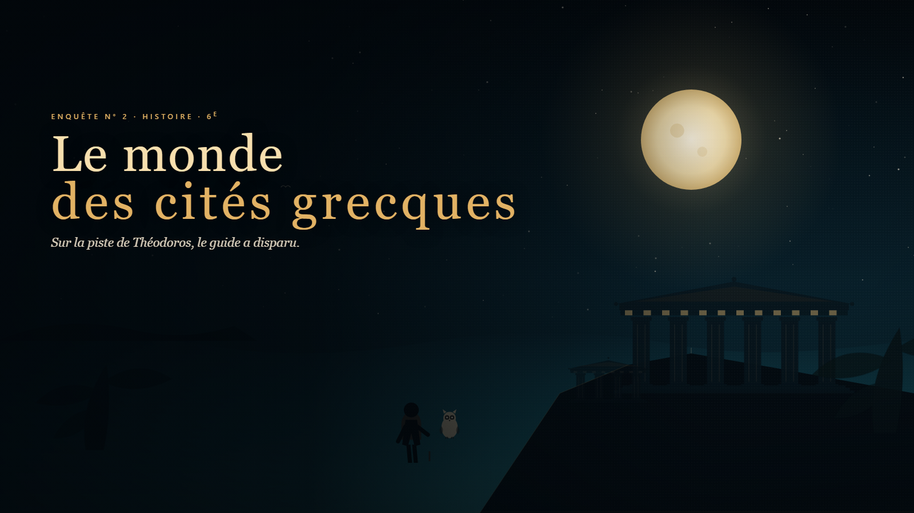

# Le monde des cités grecques

**Sur la piste de Théodoros** — un jeu de piste interactif pour la classe de 6e, à jouer sur iPad en paysage.

> **Jouer :** <https://louskyfly.github.io/enquete-cites-grecques/>  
> **Dossier professeur :** <https://louskyfly.github.io/enquete-cites-grecques/prof.html> (code `2026`)



## L'activité

Vous avez gagné un voyage en Grèce. À Patras, Théodoros, le guide, disparaît pendant la nuit. De Delphes à Athènes, du musée de l'Acropole au cap Sounion, les élèves suivent sa piste, lisent les documents, résolvent les énigmes et répondent aux 19 questions sur leur feuille.

- **Niveau :** 6e — histoire, thème 2 « Le monde des cités grecques ».
- **Durée :** 55 à 60 minutes.
- **Organisation :** un iPad par binôme, une feuille et un crayon.
- **6 actes :** le voyage, la chambre vide, Delphes, Athènes, le musée, le cap Sounion.
- **19 questions :** rédaction, QCM, choix double, billet interactif.
- **Documents :** cartes, plans, papiers, monnaie, billet, sphinx, littoral.
- **Carnet :** brouillons conservés sur l'iPad, conclusions, impression.
- **Professeur :** corrigé détaillé, déroulé, conseils et fiche élève imprimable.

Le fond reprend l'enquête n° 2 de **Yannick Sanchez** (2019, révisée en 2026). La forme est nouvelle : décors SVG originaux, navigation par scènes, pastilles d'indice, loupe, carnet numérique. Aucun scan de manuel n'est utilisé.

## Utiliser en classe

1. Ouvrir l'adresse dans **Safari** sur iPad, en paysage.
2. Ajouter la page à l'écran d'accueil si besoin (Partager → Sur l'écran d'accueil).
3. Les élèves entrent leurs deux prénoms et commencent.
4. Ils lisent, ouvrent les questions, notent les indices et rédigent sur leur feuille.
5. Le bouton **Carnet** garde les brouillons et permet d'imprimer la fiche.
6. Le professeur ouvre **`prof.html`** avec le code `2026`.

L'application fonctionne hors connexion après le premier chargement. La progression et les brouillons restent dans le navigateur de l'iPad (sauvegarde locale).

## Structure

```
index.html            l'activité élève
prof.html             le dossier professeur (code 2026)
styles.css            l'interface
data.js               récit, 19 questions, documents, conclusions
art.js                décors et documents SVG
app.js                moteur de l'enquête
cover.png             couverture
icon-*.png / icon.svg icônes iPad / PWA
manifest.webmanifest  installation sur l'écran d'accueil
sw.js                 cache hors ligne
gate.json             état d'ouverture (préparation)
.nojekyll             GitHub Pages
```

## Prévisualiser en local

```powershell
cd "C:\Users\sanch\Documents\New OpenCode Project\enquete-cites-grecques"
python -m http.server 8765 --bind 127.0.0.1
```

Puis ouvrir <http://127.0.0.1:8765/>.

Pour contrôler une scène ou une modale :

- `?scene=bus`
- `?scene=monnaie&q=q9`
- `?scene=chambre&doc=papier`

## Déploiement

Le site est statique. Il est publié par **GitHub Pages** depuis la branche `main`, à la racine.

```powershell
git add -A
git commit -m "Le monde des cités grecques — activité interactive"
git push
```

L'URL publique est <https://louskyfly.github.io/enquete-cites-grecques/>.

## Crédits

- Enquête originale : **Yannick Sanchez**, *Enquête n° 2 — Le monde des cités grecques* (2019, révisée en 2026).
- Adaptation interactive, récit, interface et illustrations SVG : 2026.
- Forme inspirée de *Mystère en Égypte*, du même atelier.
- Activité intégrée à **Clio**, la bibliothèque d'expériences.

Projet pédagogique — usage en classe.
